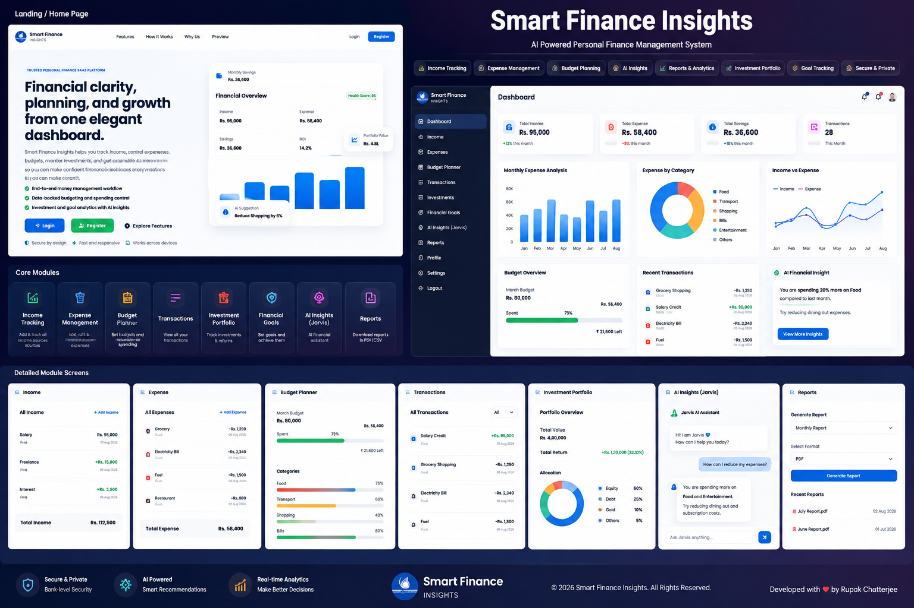

<div align="center">

# 💰 Finance Analytics Platform for Financial Reporting and Budget Tracking

### AI-Powered Personal Finance Management Platform

Manage your income, expenses, budgets, investments, financial goals, and AI-driven insights through one elegant dashboard.


</div>

---

# 📖 Overview

**Finance Analytics Platform for Financial Reporting and Budget Tracking** is a modern AI-powered personal finance management platform developed using **Flask** and **SQLite**. The platform enables users to efficiently manage their daily financial activities, monitor income and expenses, plan monthly budgets, track investments, generate professional reports, and receive AI-powered financial recommendations.

Unlike traditional expense trackers, Finance Analytics Platform for Financial Reporting and Budget Tracking combines financial management with intelligent analytics to help users make smarter financial decisions.

The application has been designed with a clean user interface, responsive layout, secure authentication system, and modular backend architecture, making it suitable for academic demonstration, portfolio showcasing, and future real-world expansion.

---

# ✨ Key Features

### 💵 Income Management

- Add monthly income
- Update income records
- Income overview
- Monthly statistics

### 💸 Expense Tracking

- Add expenses
- Edit expenses
- Delete expenses
- Category-wise tracking
- Monthly analysis

### 📊 Interactive Dashboard

- Financial summary
- Income vs Expense
- Monthly charts
- Savings overview
- Financial Health Score

### 🎯 Budget Planning

- Monthly budget creation
- Budget utilization
- Remaining balance
- Budget exceeded alerts

### 📈 Investment Portfolio

- Portfolio tracking
- Investment records
- ROI monitoring
- Asset overview

### 🤖 AI Financial Insights

- Personalized recommendations
- Spending analysis
- Smart suggestions
- Financial improvement guidance

### 📄 Reports

- Professional PDF reports
- Excel export
- Financial summaries
- Portfolio reports

### 👤 User Management

- User Registration
- Secure Login
- Profile Management
- Password Reset
- OTP Verification

### 📧 Email Services

- Welcome Email
- Password Reset OTP
- Monthly Summary
- Report Notifications
- Goal Achievement Notification

### 🔐 Security

- Secure Authentication
- Session Management
- Protected Routes
- Environment Variables
- Data Validation

---

# 🤖 AI Capabilities

Finance Analytics Platform for Financial Reporting and Budget Tracking integrates Artificial Intelligence to enhance the financial planning experience.

Current AI Features include:

- Spending behaviour analysis
- Personalized financial recommendations
- Budget improvement suggestions
- Smart financial guidance
- Future-ready AI architecture using Google Gemini

---

# 🚀 Why Finance Analytics Platform for Financial Reporting and Budget Tracking?

✔ Modern User Interface

✔ AI-Powered Decision Support

✔ Secure Authentication System

✔ Financial Analytics Dashboard

✔ Budget Planning

✔ Investment Tracking

✔ Report Generation

✔ Email Automation

✔ Professional Architecture

✔ Responsive Design

---

# 🏆 Project Highlights

- Modern Flask Architecture
- AI Integration
- Professional Dashboard
- Interactive Charts
- Modular Backend
- Production-ready Folder Structure
- Clean UI Design
- Portfolio Ready
- GitHub Ready
- Open Source Friendly

---

# 🏗️ Project Architecture

```
                    Finance Analytics Platform for Financial Reporting and Budget Tracking
                             │
        ┌────────────────────┼────────────────────┐
        │                    │                    │
   Frontend             Backend              Database
        │                    │                    │
 HTML • CSS • JS        Flask (Python)        SQLite
        │                    │                    │
        └─────────────── REST Routes ─────────────┘
                             │
                  Google Gemini AI Integration
                             │
                     AI Financial Assistant
```

---

# 📂 Project Structure

```
Smart-Finance-Insights/
│
├── app.py
├── requirements.txt
├── README.md
├── CHANGELOG.md
├── VERSION
├── .gitignore
├── .env.example
│
├── routes/
│   ├── __init__.py
│   └── jarvis.py
│
├── services/
│   ├── gemini_service.py
│   ├── report_service.py
│   ├── history_service.py
│   ├── coach_service.py
│   ├── settings_service.py
│   └── attachment_service.py
│
├── templates/
│
├── static/
│   ├── css/
│   ├── js/
│   ├── images/
│   └── uploads/
│
├── docs/
│   └── screenshots/
│
└── database/
```

---

# ⚙️ Installation Guide

## 1️⃣ Clone Repository

```bash
git clone https://github.com/Rupakrc9776/Smart-Finance-Insights.git
```

```bash
cd Smart-Finance-Insights
```

---

## 2️⃣ Create Virtual Environment

Windows

```bash
python -m venv .venv
```

Activate

```bash
.venv\Scripts\activate
```

Linux / macOS

```bash
python3 -m venv .venv

source .venv/bin/activate
```

---

## 3️⃣ Install Dependencies

```bash
pip install -r requirements.txt
```

---

## 4️⃣ Configure Environment

Create

```
.env
```

Example

```env
SECRET_KEY=your_secret_key

GEMINI_API_KEY=your_gemini_api_key

MAIL_SERVER=smtp.gmail.com

MAIL_PORT=587

MAIL_USERNAME=your_email@gmail.com

MAIL_PASSWORD=your_app_password
```

---

## 5️⃣ Run Project

```bash
python app.py
```

Open

```
http://127.0.0.1:5000
```

---

# 🛠️ Technology Stack

| Category | Technologies |
|-----------|--------------|
| Frontend | HTML5, CSS3, JavaScript |
| Backend | Python, Flask |
| Database | SQLite |
| Charts | Chart.js |
| AI | Google Gemini API |
| Authentication | Flask Session |
| Email | SMTP |
| Reports | PDF, CSV |
| IDE | Visual Studio Code |
| Version Control | Git & GitHub |

---

# 📦 Main Modules

✅ Authentication

✅ Dashboard

✅ Income Management

✅ Expense Tracking

✅ Budget Planner

✅ Transactions

✅ Investment Portfolio

✅ Financial Goals

✅ AI Assistant (Jarvis)

✅ Reports

✅ Notifications

✅ Profile Management

✅ Developer Admin Panel

---

# 🔒 Security Features

- Password Hashing
- Session Authentication
- Protected Routes
- Secure Environment Variables
- OTP Password Reset
- Input Validation
- Profile Upload Validation
- Role-based Access (Developer/User)

---

---

# 📸 Application Preview

> A modern AI-powered finance management platform featuring a clean dashboard, intelligent analytics, AI financial assistant, developer admin panel, interactive reports, and responsive user experience.

<p align="center">
  
</p>

---

# 🌟 Core Features

| Module | Description | Status |
|----------|-------------|:------:|
| 🏠 Home Page | Modern responsive landing page | ✅ |
| 🔐 Authentication | Secure login, registration & OTP reset | ✅ |
| 📊 Dashboard | Financial overview with interactive charts | ✅ |
| 💰 Income Manager | Track monthly income | ✅ |
| 💸 Expense Tracker | Manage and categorize expenses | ✅ |
| 📅 Budget Planner | Monthly budget planning & tracking | ✅ |
| 📜 Transactions | Complete transaction history | ✅ |
| 📈 Investment Portfolio | Track investments and portfolio | ✅ |
| 🎯 Financial Goals | Goal management & progress tracking | ✅ |
| 🤖 Jarvis AI | AI-powered financial assistant | ✅ |
| 📄 Reports | PDF & CSV report generation | ✅ |
| 👤 Profile | User profile & image upload | ✅ |
| 🔔 Notifications | Smart financial alerts | ✅ |
| 🛠 Developer Admin | User management & analytics | ✅ |
| 🌙 Dark / Light Theme | Theme switching | ✅ |

---

# 🛣️ Project Roadmap

## ✅ Version 1.0

- User Authentication
- AI Financial Assistant
- Expense Tracking
- Budget Planner
- Investment Portfolio
- Reports
- Notifications
- Developer Admin
- Analytics Dashboard
- Profile Management

---

## 🚀 Future Enhancements

- Google OAuth Login
- Multi-Factor Authentication (MFA)
- PostgreSQL Support
- Cloud Deployment
- Mobile Application
- AI Voice Assistant
- OCR Receipt Scanner
- Bank Statement Import
- Real-Time Stock Market Integration
- Multi-Currency Support
- Progressive Web App (PWA)

---

# 👨‍💻 Developer

**Rupak Chatterjee**

Electrical Engineering Student  
Dr. B. C. Roy Engineering College, Durgapur

📧 Email: helprupakrc@gmail.com

🔗 GitHub: https://github.com/Rupakrc9776

🔗 LinkedIn: https://www.linkedin.com/in/rupak-chatterjee-293bba2a6/

---

# 🤝 Contributing

Contributions, feature requests, and suggestions are welcome.

If you find any issue, please open an Issue or submit a Pull Request.

---

# ⭐ Support

If you found this project useful, please consider giving it a ⭐ on GitHub.

Your support motivates further improvements and future releases.

---

# 📄 License

This project is licensed under the **MIT License**.

See the LICENSE file for more details.

---

<div align="center">

## 💙 Thank You for Visiting

**Finance Analytics Platform for Financial Reporting and Budget Tracking** was developed as an AI-powered personal finance management platform to demonstrate modern web development practices, financial analytics, and AI-assisted decision making.

⭐ If you like this project, don't forget to star the repository!

</div>
